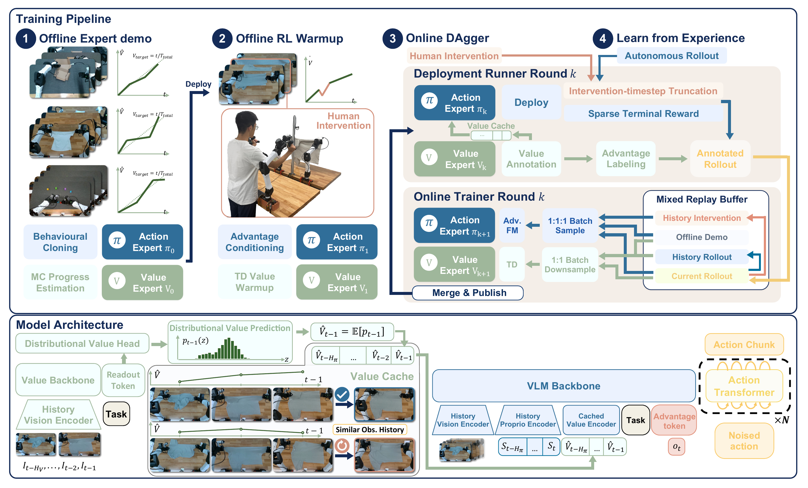

<h1 align="center">Value as Memory: Online Value-Guided Post-Training for General Robot Policies</h1>

<p align="center">
<a href="https://virlus.github.io/">Wenye Yu</a><sup>1,2,&#42;</sup>,
Yijin Chen<sup>1,&#42;</sup>,
Kaiyi Xiong<sup>1,&#42;</sup>,
Wenbo Han<sup>1</sup>,
<a href="https://wendichen.me/">Wendi Chen</a><sup>1,2</sup>,<br>
Yang Jin<sup>1</sup>,
<a href="https://hanxue.me/">Han Xue</a><sup>1</sup>,
<a href="https://lyuj1998.github.io/">Jun Lv</a><sup>1,3</sup>,
<a href="https://www.mvig.org/">Cewu Lu</a><sup>1,2,3,†</sup>,
<a href="https://alvinwen428.github.io/">Chuan Wen</a><sup>1,†</sup>
</p>

<p align="center">
<sup>1</sup> Shanghai Jiao Tong University &nbsp; · &nbsp;
<sup>2</sup> Shanghai Innovation Institute &nbsp; · &nbsp;
<sup>3</sup> Noematrix Ltd.
</p>

<p align="center">
<sup>&#42;</sup> Equal contribution. &nbsp; <sup>†</sup> Corresponding authors.
</p>

<p align="center">
  <a href="https://virlus.github.io/vam/vam.pdf"></a>
  <a href="https://virlus.github.io/vam/"></a>
</p>

<a id="contents"></a>

## 📑 Contents

- [Overview](#overview)
- [Layout](#layout)
- [Installation](#installation)
- [Getting started](#getting-started)
- [Value caching](#value-caching)
- [Acknowledgements](#acknowledgements)
- [License](#license)

<a id="overview"></a>

## 🔍 Overview

VAM conditions its action expert on a cache of past value predictions as task-progress
memory, and improves both action and value experts through offline-to-online RL.

[](docs/assets/pipeline.pdf)

| Component | Features |
| :---: | --- |
| Policy | Action expert, distributional value expert, observation history and value cache |
| Training | BC + progress initialization; TD value learning + advantage-conditioned flow matching |
| Robot | I2RT bimanual leader/follower setup with three observation cameras |
| Data | Paired LeRobot v2.1 action/value datasets, upload and registration |
| Online updates | Split action/value trainers, merged checkpoints, switching between episodes |

<a id="layout"></a>

## 📂 Layout

| Directory | Contents |
| :---: | --- |
| [`deployment/`](deployment/) | Robot and camera control, collection, inference, uploads |
| [`training/src/vam/`](training/src/vam/) | VAM model, policies and trainers |
| [`training/preprocess_data/`](training/preprocess_data/) | Frame construction, registration and annotation |
| [`training/scripts/`](training/scripts/) | Offline initialization, DAgger warmup and normalization |
| [`packages/`](packages/) | I2RT driver and VAM client |

<a id="installation"></a>

## ⚙️ Installation

Environment:

| **Component** | **Version** |
| :---: | :---: |
| Ubuntu | `24.04 LTS` |
| NVIDIA driver | `595.71.05` |
| CUDA runtime | `12.6` |
| Python | `3.11.15` |
| PyTorch | `2.7.1` |

Install `uv`, then run from the repository root:

```bash
uv sync --locked --python 3.11                   # Training environment
uv sync --locked --python 3.11 --extra hardware  # Robot host: adds I2RT and RealSense
```

Dependencies are pinned in [`uv.lock`](uv.lock) and installed into `.venv/`.

<a id="getting-started"></a>

## 🚀 Getting started

1. Install the environment above on each host.
2. Configure the robot using the [deployment guide](deployment/README.md#configuration).
3. Follow the workflow that matches your task:

The five guides below cover preparation and the paper’s four training stages (Sec. 3.3,
Algorithm 1). “Offline DAgger warmup” corresponds to the paper’s **offline RL warmup**.

| Step | Guide | Result |
| :---: | :---: | --- |
| 1 | [Data collection](deployment/README.md#data-collection) | Successful expert demonstrations (`D_demo`) in paired LeRobot datasets |
| 2 | [Initialize with offline dataset](training/README.md#initialize-with-offline-dataset) | BC-initialized action expert + progress-initialized value expert |
| 3 | [Offline DAgger warmup data collection](deployment/README.md#offline-dagger-warmup-data-collection) | Warmup rollout dataset with human interventions and episode outcomes |
| 4 | [Offline DAgger warmup](training/README.md#offline-dagger-warmup) | TD-trained value expert + advantage-conditioned policy |
| 5 | [Online DAgger/Learn from Experience](docs/online.md) | Updated action/value pair each round + accumulated rollout replay |

**References:** \[[Model and RTC](training/docs/vam_model_release.md)\] \[[Data tools](training/preprocess_data/README.md)\]

<a id="value-caching"></a>

## 🧠 Value caching

**Past value predictions give the policy task-progress memory:** improving, stalled
or declining progress helps distinguish visually similar situations that need different actions.

| Step | Implementation | Code |
| :---: | --- | :---: |
| Predict | Compute scalar values asynchronously and cache them with observation timestamps. | [Value&nbsp;worker](deployment/consumer/policy_connector.py) |
| Assemble | Align past values with observation history; mask missing entries and the current value. | \[[History&nbsp;assembly](deployment/consumer/policy_connector.py)\]<br>\[[Input&nbsp;masks](training/src/vam/policies/async_aloha_policy.py)\] |
| Encode | Project the history through a masked GRU into one token that conditions the action expert. | \[[History&nbsp;encoder](training/src/vam/models/utils/history.py)\]<br>\[[Model](training/src/vam/models/vam.py)\] |

The public example enables value caching with these settings:

```yaml
# Deployment policy settings; keep history and normalization matched to the checkpoint.
policy:
  params:
    pi_config_name: pi05_aloha_history_value_expert  # Recipe with state/value history tokens
  enable_value_prediction: true  # Predict and cache timestamped values
  history_with_value: true       # Include past values in the action input
```

**References:** \[[Paper §3.2](https://virlus.github.io/vam/vam.pdf)\] \[[Training recipe](training/src/vam/training/config/__init__.py)\] \[[Deployment settings](deployment/configs/policy/vam.yaml)\] \[[Model guide](training/docs/vam_model_release.md)\]

<a id="acknowledgements"></a>

## 🙏 Acknowledgements

We are grateful to the teams behind [OpenPI](https://github.com/Physical-Intelligence/openpi)
and I2RT for sharing their work with the community. OpenPI provides the foundation
for our policy and training implementation, while I2RT supports our robot deployment.

<a id="license"></a>

## 📄 License

This project is released under the [Apache License 2.0](LICENSE).
